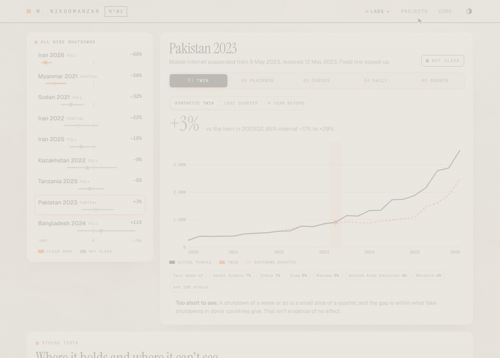
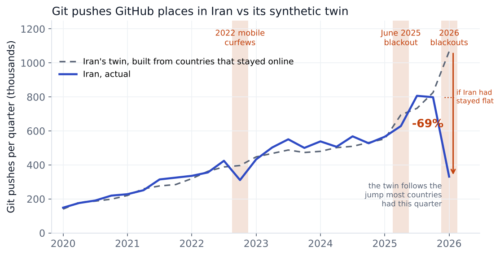
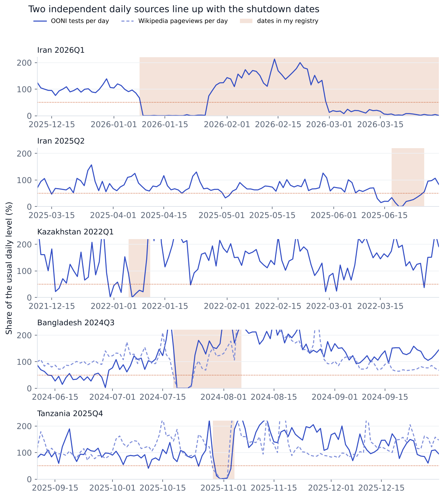
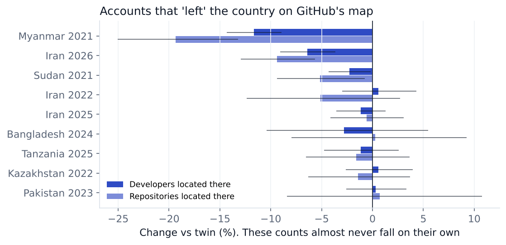
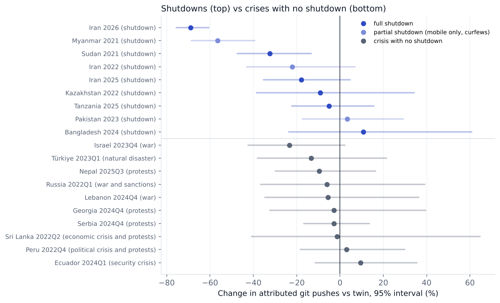
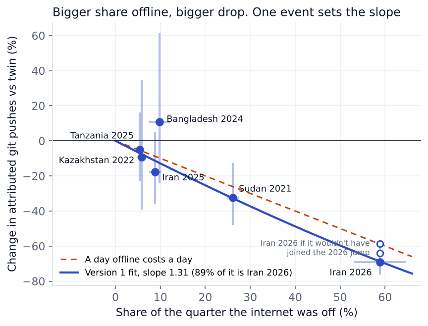
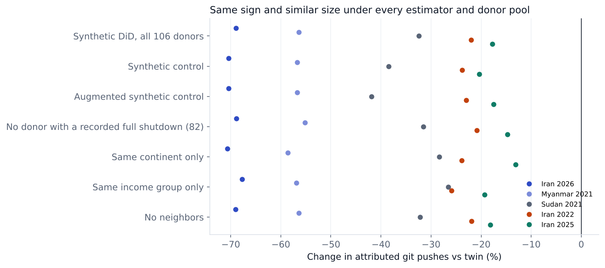
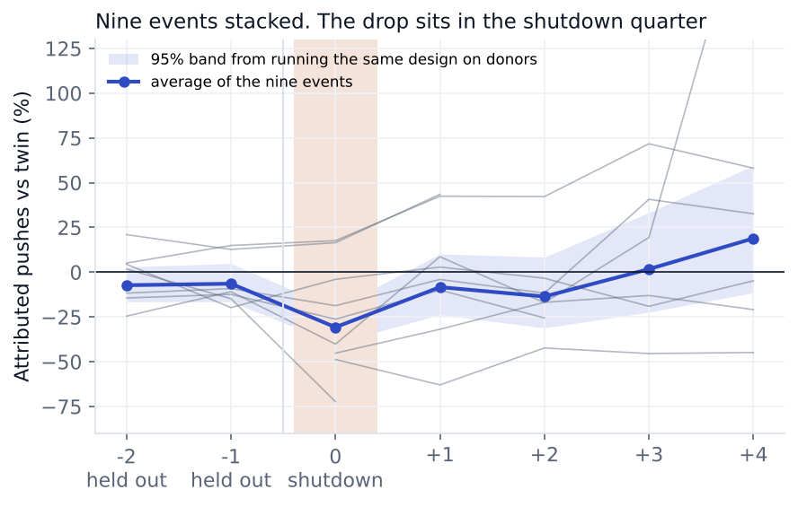
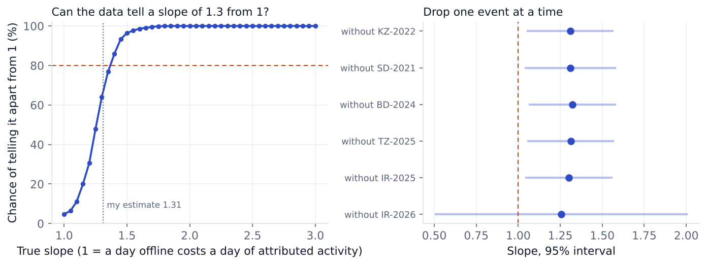

# What happens to a country's GitHub activity when its internet goes dark?

Iran was offline for about half of early 2026, and the GitHub activity placed in Iran came in 59% to 69% below what a synthetic twin predicts. Myanmar after its 2021 coup is the only other drop that big.



The shutdowns page switching from Pakistan 2023 to Iran 2026, then showing why Iran is a range from 59% to 69%.

When a government shuts off a country's internet, nobody can run the same country with the internet left on, so there's no A/B test. I built each country a synthetic twin out of countries that stayed online and measured the gap, using GitHub's public [Innovation Graph](https://github.com/github/innovationgraph). Then I spent most of the time trying to break that gap.

## The short version

The git pushes GitHub places in Iran came in 69% below its twin (95% interval 61% to 76%), or 59% below if Iran would have stayed flat while most of the world jumped that quarter. Myanmar after its 2021 coup came in 56% below. Iran passes every check I wrote down before running them. Myanmar passes every one that can be run on it, but it has so little history before the coup that those checks are weak for it (more under limits). Shutdowns of a week or so don't show up in quarterly data. Keep in mind that this is GitHub's map of where code comes from and says nothing about a country's economy, and part of the drop is people on VPNs getting counted in other countries.

Read the [paper](paper/paper.pdf), the [one page memo](memo/memo.pdf), the [analysis plan](paper/analysis_plan.pdf), the [report card for each event](reports/) or the [interactive version](https://matinnikoo.github.io/shutdowns.html).

The memo is the one page version. The paper has everything else, and the analysis plan is the list of tests and wording rules I wrote before running the new checks.



## The question

When a country goes offline, how much does the GitHub activity attributed to that country fall compared with what similar countries predict? And how much of that is real lost work and how much is activity that keeps happening but gets placed somewhere else?

The data can answer the first part. It can only partly answer the second. GitHub places each developer in the country their IP address shows on most days of the quarter, so a VPN user counts wherever the VPN exits. Everything below is about geographically attributed GitHub activity. It says nothing about productivity or output, and none of it measures what a shutdown costs the economy.

## Try it

```bash
pip install -r requirements.txt
pip install -e .
shutdowns estimate --event IR-2026
```

That takes a few seconds. It prints the headline and writes a one page report card (figure, markdown, PDF and json) to `reports/custom/`. Without the second line, `python -m shutdowns` from the repo folder does the same thing. The [tutorial](docs/tutorial.md) walks through this one event from start to finish, and [docs/cli.md](docs/cli.md) lists the output formats.

| Command | What it does |
|---|---|
| `estimate` | Runs the full design (synthetic DiD, synthetic control, augmented synthetic control, placebos, conformal test, backdating, breakdown value, leave one donor out) for a registry event, or for any economy and any quarters. Dates work and are read as the quarter they fall in. `--outcome` picks pushes, developers, repositories or organizations, or `all` for the four with one comparison plot. `--donors` swaps the donor pool. `--html` adds a single page card you can email, `--format csv` or `json` prints the numbers instead |
| `compare` | Two events side by side, a registry id or something like `IR:2022Q4`, with a plot on one time axis and the difference between the two effects |
| `cards` | A report card for every registry event, plus `reports/index.md` |
| `events` | The registry, filtered by country or kind, with my estimates added by `--results`, as a table, csv or json |
| `economies` | Every economy in the panel and whether it can serve as a donor |
| `validate`, `refresh` | Check the registry, and look for new Innovation Graph quarters |

```bash
shutdowns compare IR-2026 MM-2021
shutdowns estimate --economy Iran --start 2022-09-21 --end 2022-12-31 --outcome all --html
shutdowns estimate --economy BD --start 2024Q3 --format csv > bd.csv
```

`shutdowns <command> --help` explains every option.

## What I found

| Shutdown | vs twin | 95% interval | Synthetic control | Augmented SC | Holm p | Holm p, permutation | Passes every check |
|---|---|---|---|---|---|---|---|
| Iran 2026, blackout from 8 Jan, near total cut from 28 Feb | −69% | −76% to −61% | −70% | −70% | <0.001 | 0.08 | yes |
| Myanmar 2021, coup, nightly cuts, mobile data off | −56% | −69% to −39% | −57% | −57% | <0.001 | 0.15 | every one that can be run (only 4 quarters before, can't backdate) |
| Sudan 2021, 24 day cut after the coup | −32% | −47% to −13% | −38% | −42% | 0.01 | 0.15 | no, fails backdating |
| Iran 2022, mobile curfews during protests | −22% | −43% to +7% | −24% | −23% | 0.66 | 0.45 | no |
| Iran 2025, about a week during the June war | −18% | −35% to +5% | −20% | −18% | 0.66 | 0.45 | no |
| Kazakhstan 2022, about 5 days | −9% | −39% to +34% | −15% | −14% | 1.00 | 1.00 | no |
| Tanzania 2025, 5 days around the election | −5% | −22% to +16% | +4% | +1% | 1.00 | 1.00 | no |
| Pakistan 2023, mobile only, 4 days | +3% | −17% to +29% | +7% | +8% | 1.00 | 1.00 | no |
| Bangladesh 2024, 7 to 11 days | +11% | −24% to +61% | +6% | −1% | 1.00 | 0.60 | no |

The checks are the ones in the [analysis plan](paper/analysis_plan.pdf). Holm p corrects for testing nine events. The plan fixed the first Holm column, which takes the placebo spread as roughly normal. The placebo gaps have heavy tails (a few donors have huge ones), so I added the second column, Holm on the exact permutation p value. With 106 donors the smallest permutation p is 1/107, and times nine events that is 0.08, so that column can never get below 0.08. Iran 2026 sits exactly on it. Dates, scope and a source for every event are in [data/events.csv](data/events.csv).

### Iran 2026 is a range

Most countries' pushes jumped about 30% in 2026Q1 (the median donor was up 30%, and 74% of donors grew by more than 20%). The first quarters of 2021 to 2025 had median growth between 0% and 9%. Most of the 2026 jump is more pushes per developer (+20%) rather than more developers (+9%). I haven't found the cause, and I'm not going to guess at one. Iran's twin is a mix of countries that took part in it. Countries under broad sanctions mostly didn't (Russia −2%, Belarus +3%, Cuba +12%), though Venezuela grew 48%. If Iran would have missed the jump too, the drop is 59% to 64%. That's why I give the range 59% to 69%.

### Data that has nothing to do with GitHub lines up with the dates

OONI volunteers run network tests every day, and the count falls toward zero when a country goes dark. It shows Iran offline for 49 days in 2026Q1 (my registry says 48 to 58), and it finds a blackout inside the registry dates for all five full shutdowns where it has enough tests. If I treat the five as independent, the chance of that lining up by luck is about 1 in 4,000. Wikipedia pageviews date Bangladesh 2024 and Tanzania 2025 to the day.



### Some of the activity moved instead of stopping

Repository and organization counts include dead projects, so they almost never shrink. Repositories fall more than 2% in only 0.9% of country quarters. In 2026Q1 Iran's repositories fell 4.5% and its organizations 5.1%, the first time Iran's repository count ever went down. Myanmar's repositories fell 14.2% in 2021Q2. A project doesn't stop existing when its owner goes offline, but it gets placed in another country when its members show up from other IP addresses, which is what VPN use looks like. The other way a count falls is GitHub removing projects, and I can't rule that out from outside.

Developers behave differently. The developer count placed in Iran still grew 1.0% in 2026Q1, even though repositories and organizations fell under the same location rule. I don't have a tested explanation for that.



### Crises alone move this too

I ran the same design on 10 crises that came with no full shutdown (wars, an earthquake, protest waves, sanctions). None came out significant, but Israel after 7 October 2023 was 23% below its twin, so a drop of 20% can't be pinned on the internet. Iran 2026 and Myanmar 2021 are more than twice as big as anything in the controls. The controls are noisy, so they only rule out crisis effects that big.

I picked the 10 on 20 October 2026, right after writing the plan and before running them. The plan fixes the test and how many rejections are allowed, but not the list. I searched for major crises from 2021 to 2025 in donor countries and kept the ones where Access Now has no full network record in that quarter. The sources are in [data/negative_controls.csv](data/negative_controls.csv).



### Which donors

The donor pool is 106 countries with no shutdown in my registry. That is a weaker rule than it sounds, because 24 of them do have a full network shutdown in the Access Now tracker for 2020 to 2025. Ethiopia is the clearest case, with a 38 day nationwide full network shutdown from 30 June to 6 August 2020. The plan fixed the full pool as the main one, so it stays the main one. Next to it I ran the 82 donors with no full network record at all.

| | 106 donors | 82 donors |
|---|---|---|
| Iran 2026 | −69% (−76% to −61%) | −69% (−75% to −61%), permutation p 0.012 |
| Myanmar 2021 | −56% (−69% to −39%) | −55% (−64% to −44%), permutation p 0.012 |
| Sudan 2021 | −32% (−47% to −13%) | −32%, permutation p 0.024 |

Ethiopia has the largest placebo gap in 3 of the 9 windows (Kazakhstan, Myanmar and Pakistan), and it is the only donor with a bigger placebo gap than Myanmar. That is why Myanmar's permutation p is 0.019 (2 of 107) in the full pool and 0.012 in the 82 pool.

### Pooling the shutdowns

The six full shutdowns average 29% below their twins (95% 22% to 37%), and 14% without Iran 2026 (p = 0.021). That 14% is carried by Sudan 2021, which lasted 24 days and fails backdating. The four full shutdowns of 11 days or less (Kazakhstan, Bangladesh, Tanzania and Iran 2025) pool to −7.8% (95% −19% to +5%, p = 0.214). So I can't see a shutdown of that length in quarterly data, and I can't rule out a small effect either.

### The four GitHub counts

For the three events with a significant drop in pushes, developers, repositories and organizations all fall against the twin too. For the other six, nothing does except Bangladesh's organizations.

## What changed from version 1

| Claim | Version 1 | Now | Why |
|---|---|---|---|
| Iran 2026 | −69% | −59% to −69% | the twin assumes Iran joins the 2026 jump, and sanctioned countries mostly didn't |
| "Each day offline cost 1.3 days of work" | β = 1.31 (1.06 to 1.56) | dropped | 89% of the fit is Iran 2026, it's 1.02 if Iran missed the jump, and the data tells 1.3 from 1 only 64% of the time |
| Developers "fell" 6% in Iran, 12% in Myanmar | location drift | gap to the twin, not a fall | Iran's developer count still grew 1.0%. Repositories and organizations are the counts that actually fell |
| Headline | days of work lost | change in attributed GitHub activity | the outcome is GitHub's map, and VPN users get moved |
| Sudan 2021 | −32%, clear | −32%, not clear | the twin misses the two quarters before by −25% and −11% when they're held out, and Access Now records exam shutdowns in exactly that stretch |
| Donor pool | 106 countries with no listed shutdown | 106 with no shutdown in my registry | 24 of them have one in the Access Now tracker |

### What is left of the dose response

Bigger shares of the quarter offline go with bigger drops in attributed pushes. I measure the share with OONI's count of disrupted days instead of my own day counts, and the slope on the log scale is 1.39 (1.10 to 1.67). It is positive, which was the planned test. The plan only lets me say anything about a slope of exactly 1 if the interval is narrower than 0.5, and this one is 0.57 wide, so I don't say anything about it.

Three things weaken even the positive result. Iran 2026 carries it, and without it the slope is 0.53 (−0.34 to 1.41). Pakistan 2023 gets an exposure of 14% from OONI, but those disrupted days are in April, before the 9 to 12 May cut, so that number is noise. Iran 2022 gets 2% because the evening mobile curfews don't show up in OONI. Counting only days inside each event's registry window gives 1.48 (1.18 to 1.77), and using only the five full shutdowns gives 1.45 (1.15 to 1.74), so neither problem changes the slope much.



## How it works

### The data

Quarterly git pushes, developers, repositories and organizations for every economy from 2020Q1 to 2026Q1, built into a panel with SQL ([sql/panel.sql](sql/panel.sql), run in DuckDB). The donor pool is 106 countries with no shutdown in my registry and at least 10,000 pushes every quarter. Everything is in logs, so effects come out as percentages. GitHub's repo had no newer quarters when I checked on 20 October 2026, and my copy is byte for byte the same as the pinned commit ([data/provenance_github.json](data/provenance_github.json)).

### Three estimators

All three pick donor weights so the mix moves like the treated country before the event, solved exactly as nonnegative least squares.

* Synthetic difference in differences (Arkhangelsky et al. 2021) is the headline. It spreads the weight over more countries and also weights the pre quarters.
* Synthetic control (Abadie, Diamond and Hainmueller 2010), demeaned so the twin can sit at a different level (Ferman and Pinto 2021).
* Augmented synthetic control (Ben-Michael, Feller and Rothstein 2021) fixes whatever pre period mismatch is left with a ridge regression.

### How sure

The standard error is the larger of two placebo spreads. Every donor gets the fake event (in space), and the country gets fake events in earlier quarters (in time). On top of that there is a conformal test (Chernozhukov, Wüthrich and Zhu 2021). It can't go below one over the number of quarters, so it only decides anything for Iran 2026 (p = 0.045, the smallest possible).

### What would have to go wrong

Holding out the last two pre quarters turns them into real out of sample checks (backdating). The alternative donor pools drop every country with a full network shutdown in the Access Now tracker (24 of them), or keep only the same continent, the same income group, or no neighbors. Then each donor with a real weight is left out in turn. Nothing moves Iran 2026 or Myanmar 2021 by more than one standard error. In the spirit of Rambachan and Roth (2023), Iran 2026 only goes away if the twin's path is off by 3.4 times the worst miss it ever made in Iran's own history.



### Stacked

I refit each event with its last two pre quarters held out and stacked them. Myanmar has no hold-out, and the two held out quarters have eight and seven events. The drop sits right in the shutdown quarter (−31%, p < 0.001). The two quarters before average −7% and −6%. That isn't significant, but it leans toward a slowdown before the event, which a political crisis would cause.



## Can quarterly data even answer the follow-up questions?

Before reading any difference I simulated the smallest one the data could catch 80% of the time, drawing each event's error from its own placebos.

* Duration. It can tell that longer shutdowns cost more. It can't tell a day costing a day from a day costing 1.3 days (64% power), and without Iran 2026 it can't tell much of anything.
* Full vs partial. Detectable difference 0.27 in logs. The estimate is −0.11 (se 0.10), so nothing, but the partial group includes Myanmar's months of cuts, so it isn't a clean comparison.
* Big vs small developer communities. Detectable difference 0.19 in logs per tenfold size. Across the 2 tenfolds of size in my events that comes to 0.39, about the size of a month offline (0.40), so the question is only barely answerable. The estimate is 0.014 (se 0.072), so there's no sign that size matters.



## Checking the methods on fake shutdowns

`analysis/simulations.py` plants shutdowns of known size into countries that never had one, at random quarters, 250 times for each size.

| Planted drop | About this many days | Synthetic DiD flags it | Synthetic control flags it | Interval covers the truth |
|---|---|---|---|---|
| 0% | none | 1.6% (false alarms) | 2.8% | 98% |
| 10% | 9 | 6% | 3% | 99% |
| 20% | 18 | 41% | 26% | 97% |
| 35% | 32 | 88% | 81% | 99% |
| 50% | 46 | 95% | 93% | 98% |

Those simulations use at least 8 quarters before the event and donors with at least 10,000 pushes, so they don't speak for Myanmar or Sudan. I ran a smaller set for those settings in `analysis/short_history.py`, 200 fake events each. With 4 quarters before and 2 after (Myanmar's shape) the false alarm rate is 4.0% with the normal p value and 2.0% with the permutation p. With 7 before and 1 after (Sudan's shape) it is 4.5% and 3.5%, and 7.9% with small donors. In both settings there are too few earlier quarters to draw time placebos, so the standard error comes from the donors alone.

The tests also plant effects in simulated panels for all three estimators, check that a planted effect moves the estimate by exactly its size (which is what makes the power simulations cheap), and check that the placebo test rejects about 5% of the time when nothing happened.

## Rerun everything

```bash
pip install -r requirements.txt
make all      # every result, figure, report card, the released dataset and the papers, a few minutes
make sims     # the planted shutdowns, about 25 minutes
make data     # download GitHub, Access Now, OONI and Wikimedia data again
make cards    # only the report cards
make test     # the tests, about a minute
```

The cleaned panel and the event table are in [data/release/](data/release/) with a [data card](data/release/DATACARD.md), so you can use the data without running anything. The raw GitHub clone and the Access Now spreadsheet are not kept in the repo. `make data` (or the first `analysis/fetch_data.py` call that needs them) downloads them again into `data/external/`, or into the folder in `SHUTDOWNS_EXTERNAL` if you set it.

## What this can't tell you

* It's GitHub's map. Private repos and everything off GitHub are missing, and VPN users count wherever their VPN exits. Some of each drop is reassignment, and I can't say how much. I looked for the moved activity in likely VPN exit countries, but that test could miss 23 times the whole missing amount, so it has no power. I fixed the list of exit countries before running that check, though not before seeing the Iran 2026 number, which version 1 had already published.
* Each number covers the whole quarter. Iran's 2026 blackouts came with mass protests after a currency collapse and then US and Israeli strikes from 28 February. Myanmar's and Sudan's came with coups. The controls show a crisis alone can move this by about 20%.
* The twin is an assumption. For Iran 2026 the answer depends on whether Iran would have joined the 2026 jump, which moves it between −59% and −69%. I also don't know why the jump happened, so I can't check that GitHub's measurement stayed stable across it.
* Short shutdowns are invisible one at a time. Kazakhstan, Tanzania, Pakistan and Bangladesh don't show "no effect". They show that quarterly data can't see it.
* Myanmar passing every check that can be run is weaker than it sounds. It has four quarters before the coup, so its breakdown benchmark is the fit of those same four quarters (a miss of 0.022 in logs and a breakdown value of 22.7, which can hardly fail). Its time placebo spread is zero because there are too few earlier quarters, so its standard error comes from the donors alone. Its conformal p value sits at the floor of 0.167. In the fake shutdown runs for its setting the false alarm rate was about 4% (2% with the permutation p). Sudan has seven quarters before and the same problem to a smaller degree.
* OONI is noisy outside big countries. In quiet quarters for countries with fewer than 1,000 tests a day, it looks "disrupted" on 79% of days at the 95th percentile, so it's good for dates and weak for depth except for Iran. Wikimedia only covers Bangladesh and Tanzania here, since Iran and Myanmar are never published.
* Nobody independent has checked this yet.

## Repo

| Path | What it is |
|---|---|
| `shutdowns/` | The package. `synth.py` (three estimators), `inference.py` (placebos, conformal), `sensitivity.py`, `exposure.py`, `power.py`, `registry.py`, `design.py` (the full design in one call), `report.py` (cards, HTML, plots), `compare.py`, `specs.py` (reads quarters, dates and country names), `cli.py` |
| `analysis/` | One script per result. `run_events.py`, `identification.py`, `outcomes.py`, `exposure.py`, `heterogeneity.py`, `stacked.py`, `discover.py`, `short_history.py`, `simulations.py`, `figures.py`, `release.py`, `paper_numbers.py`, `fetch_data.py`, `export_site.py` |
| `data/events.csv` | Event registry with dates, scope, networks, day counts and sources, validated by tests |
| `data/` | Innovation Graph (`raw/`), Access Now records (`keepiton/`), OONI daily counts (`ooni/`), Wikimedia pageviews (`wikimedia/`), negative controls, regions and neighbors |
| `results/` | Every number, as JSON |
| `reports/` | One report card per event, with an index |
| `docs/` | The [tutorial](docs/tutorial.md) and the [command line reference](docs/cli.md) |
| `paper/` | The working paper and the analysis plan. Every number in it comes from `paper/numbers.tex`, written by code |
| `memo/` | The one page version |
| `tests/` | Estimators on simulated panels, the registry, the outside data, the command line (every command and error), the site export, and a test that recomputes most of the numbers quoted in this README from `results/` |

## References

* Abadie, Diamond and Hainmueller (2010). Synthetic control methods for comparative case studies.
* Arkhangelsky, Athey, Hirshberg, Imbens and Wager (2021). Synthetic difference in differences.
* Ben-Michael, Feller and Rothstein (2021). The augmented synthetic control method.
* Chernozhukov, Wüthrich and Zhu (2021). An exact and robust conformal inference method for counterfactual and synthetic controls.
* Ferman and Pinto (2021). Synthetic controls with imperfect pretreatment fit.
* Rambachan and Roth (2023). A more credible approach to parallel trends.

## Licenses

The MIT license covers the code only. The data keeps the license of its source.

| Source | Where it is used | License |
|---|---|---|
| GitHub Innovation Graph | `data/raw/`, the GitHub columns of `data/release/panel.csv` | CC0 |
| Access Now KeepItOn | `data/keepiton/shutdowns_2020_2025.csv` (a 1,418 row extract of the whole tracker plus a few columns I derived), the `keepiton_full_network` column | CC BY 4.0, credit Access Now |
| OONI | `data/ooni/daily_measurements.csv.gz`, the `ooni_*` columns of `data/release/panel.csv` and `events.csv` | CC BY-NC-SA 4.0 |
| Wikimedia pageviews | `data/wikimedia/` | CC0 |

Because of the OONI columns, `data/release/panel.csv` and `data/release/events.csv` are CC BY-NC-SA 4.0 as they stand. That means attribution, no commercial use and share alike. Without those columns the rest is CC0 plus the Access Now flag under CC BY 4.0. The [data card](data/release/DATACARD.md) says the same.
