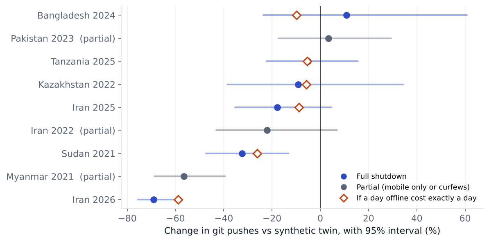
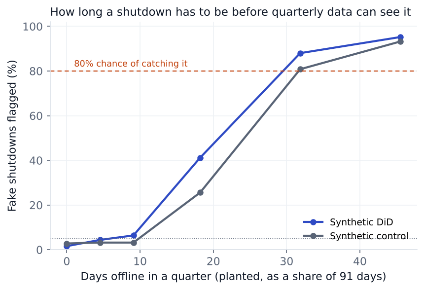

# What does it cost to turn off the internet?

When a government shuts off a country's internet, nobody can run the same country with the internet left on. So there's no A/B test. I built each country a **synthetic twin** out of countries that stayed online, and measured the gap. The data is GitHub's public [Innovation Graph](https://github.com/github/innovationgraph), which counts how much code every country pushes each quarter.

**Interactive version:** [matinnikoo.github.io/shutdowns.html](https://matinnikoo.github.io/shutdowns.html) · **One page memo:** [memo/memo.pdf](memo/memo.pdf)


## What I found

Long shutdowns are huge. Iran's two blackouts in early 2026 cut its coding activity by **69%** compared with its twin (95% interval 61% to 76%). Myanmar after the 2021 coup fell 56%, and Sudan after its 2021 coup fell 32%.

People don't catch up afterward. Across the six full shutdowns, each day offline cost about **1.3 days** of work (95% interval 1.06 to 1.56). If people made up the lost time, that number would be under 1, and it never was.

Some of the drop is people still coding, just from somewhere else on the map. GitHub places accounts by where their connections come from. The number of developers placed in a country basically never goes down, but it fell 6% in Iran in early 2026 and 12% in Myanmar in 2021. That's what VPN use or people leaving would look like.

Short shutdowns don't show up at all. In simulations a shutdown has to last about a month before it gets caught 80% of the time. So the five to eleven day ones in Kazakhstan, Tanzania and Bangladesh are invisible here. That's a limit of quarterly data, it doesn't mean they did no harm.

Simple comparisons can point the wrong way. Next to the same quarter a year earlier, Iran's June 2025 blackout quarter looks like **+24%** growth. Next to its twin it's **18% lower**, because everyone else grew even faster.

| Shutdown | What happened | vs twin | 95% interval | If a day cost a day |
|---|---|---|---|---|
| Iran, 2026 Q1 | Blackout from 8 Jan, then a near total cut from 28 Feb | **−69%** | −76% to −61% | −59% |
| Myanmar, 2021 Q1 and Q2 | Coup, nightly cuts, all mobile data off from 15 Mar | **−56%** | −69% to −39% | partial |
| Sudan, 2021 Q4 | Fixed and mobile cut for 24 days after the coup | **−32%** | −47% to −13% | −26% |
| Iran, 2022 Q4 | Mobile curfews and app blocks during protests | −22% | −43% to +7% | partial |
| Iran, 2025 Q2 | Near total blackout for about a week in June | −18% | −35% to +5% | −9% |
| Kazakhstan, 2022 Q1 | Nationwide for about 5 days | −9% | −39% to +34% | −6% |
| Tanzania, 2025 Q4 | Nationwide for 5 days around the election | −5% | −22% to +16% | −5% |
| Pakistan, 2023 Q2 | Mobile only, 4 days | +3% | −17% to +29% | partial |
| Bangladesh, 2024 Q3 | Nationwide for about 7 to 11 days in July and August | +11% | −24% to +61% | −10% |

Dates, scope and sources for every event are in [data/events.csv](data/events.csv).



## How it works

**The data.** Quarterly git pushes for every economy from 2020 Q1 to 2026 Q1, built into a panel with SQL ([sql/panel.sql](sql/panel.sql), run in DuckDB). The donor pool is 106 countries with no listed shutdown and at least 10,000 pushes in every quarter. Everything is on the log scale, so effects come out as percentages.

**Two methods.** Both pick weights for the donor countries so the weighted mix moves like the treated country before the event.

* *Synthetic control* (Abadie, Diamond and Hainmueller 2010), in the demeaned form so the twin can sit at a different level and only has to match the shape (Ferman and Pinto 2021).
* *Synthetic difference in differences* (Arkhangelsky et al. 2021). It adds a penalty that spreads the weight over more countries and also weights the pre period quarters, which made it more precise here. It's the headline method.

The weights are solved exactly as a nonnegative least squares problem. A test checks the solver against the Frank Wolfe method from the paper.

**How sure.** Two kinds of placebo. In space, every donor country gets the fake shutdown and goes through the same method, which shows how big an "effect" appears by chance. In time, the treated country gets fake shutdowns in earlier quarters, which measures how noisy that particular country is. Small countries like Sudan are much noisier than the big donors, so the standard error is the larger of the two.

**Did a day cost a day?** If coding just pauses while the internet is off, a quarter with share s offline should land at (1 − s) of its twin. I fit measured = β × predicted on the log scale across the six full shutdowns, weighted by precision. β = 1 means a day costs a day, β < 1 means people made it up, β > 1 means the damage outlasted the outage.


## Checking the methods on fake shutdowns

I can't check the real answer, so `analysis/simulations.py` plants shutdowns of known size into countries that never had one, at random quarters, 250 times for each size.

| Planted drop | About this many days | Synthetic DiD flags it | Synthetic control flags it | Interval covers the truth |
|---|---|---|---|---|
| 0% | none | 1.6% (false alarms) | 2.8% | 98% |
| 10% | 9 | 6% | 3% | 99% |
| 20% | 18 | 41% | 26% | 97% |
| 35% | 32 | 88% | 81% | 99% |
| 50% | 46 | 95% | 93% | 98% |

Bias stays within about 1.5 percentage points at every size. False alarms stay under 5%, and the intervals cover the truth a bit more often than 95%, so they're on the cautious side. Synthetic DiD catches more real drops than synthetic control at every size, which is why it's the headline method.



## Robustness

The clear results barely move under different choices (synthetic DiD, change vs twin).

| | Iran 2026 | Myanmar 2021 | Sudan 2021 | Iran 2022 |
|---|---|---|---|---|
| Main estimate | −69.0% | −56.4% | −32.5% | −22.0% |
| Only donors with 50k+ pushes a quarter | −68.4% | −55.7% | −32.8% | −20.7% |
| Only donors with 200k+ | −68.0% | −56.3% | −27.3% | −21.1% |
| Drop the biggest donor | −68.7% | −56.7% | −31.5% | −22.4% |
| Only the last 8 pre quarters | −68.9% | n/a | n/a | −23.0% |
| Plain synthetic control | −70.4% | −56.8% | −38.4% | −23.8% |

## What this can't tell you

* Shutdowns come with coups, protests and war, so each estimate is the cost of everything that happened that quarter. The dose response is how I get at the internet part, since it asks whether the days offline explain the drop on their own.
* The twin assumes the country would have kept up with its donors. In early 2026 most countries jumped about 30% and Iran's twin jumps with them. If Iran would have stayed flat instead, the drop is 59%, which is exactly what its days offline predict. So the conclusion holds either way.
* Myanmar only has four quarters before the coup, so its twin is built on very little history.
* GitHub locates activity by IP address, so VPNs move it to other countries. That hurts the main numbers a bit, and it's also what the location finding is built on.
* The day counts are rough. Iran's January 2026 restoration was partial and uneven, so I use a range of 48 to 58 days. With the low count β is 1.51, with the high count 1.14.

## Repo

| Path | What it is |
|---|---|
| `sql/panel.sql` | Builds the country by quarter panel in DuckDB |
| `data/events.csv` | Every shutdown, with dates, days offline and a source |
| `shutdowns/synth.py` | Synthetic control and synthetic DiD |
| `shutdowns/inference.py` | Placebo tests in space and time |
| `analysis/run_events.py` | All estimates, the dose response, location drift and robustness |
| `analysis/simulations.py` | Planted shutdowns |
| `analysis/figures.py` | Charts |
| `tests/` | 16 tests |
| `memo/memo.pdf` | The one page version for someone who has two minutes |

```bash
pip install -r requirements.txt
pytest -q
python analysis/run_events.py
python analysis/simulations.py      # about 25 minutes
python analysis/figures.py
```

## References

* Abadie, Diamond and Hainmueller (2010). Synthetic control methods for comparative case studies.
* Arkhangelsky, Athey, Hirshberg, Imbens and Wager (2021). Synthetic difference in differences.
* Ferman and Pinto (2021). Synthetic controls with imperfect pretreatment fit.
* Abadie (2021). Using synthetic controls, feasibility, data requirements, and methodological aspects.
* GitHub Innovation Graph, released under CC0.

## License

MIT for the code. The GitHub data is CC0.
