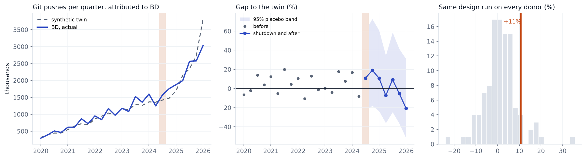

# Bangladesh, 2024

Change in git pushes GitHub attributes to **BD** in 2024Q3, compared with a synthetic twin built from 106 economies. 18 quarters before the event are used to build the twin.

| Method | Change vs twin | 95% interval | p (normal) | p (permutation) |
|---|---|---|---|---|
| Synthetic DiD | +10.8% | -24% to +61% | 0.589 | 0.150 |
| Synthetic control | +6.1% | -22% to +45% | 0.708 | 0.402 |
| Augmented synthetic control | -1.2% | -25% to +30% | 0.933 | 0.841 |

**Checks**

* Conformal test. p = 0.789. With 19 quarters the smallest possible p is 0.053, so this test can't give an interval here.
* Backdating. Fitting without 2024Q1 and 2024Q2, the twin misses those quarters by +4%, -20%. Inside the placebo band.
* Breakdown. The interval already includes zero, so there is nothing to break.
* Leave one donor out. Dropping each of the 18 donors with weight over 1% keeps the estimate between +9.7% and +12.1%.
* Holm adjusted p across the nine registry events is 1.000. Does not pass every check in the analysis plan, so I don't call it a clear drop.
* What happened. Nationwide shutdown from 18 Jul 2024, broadband back 24 Jul, mobile back 28 Jul, second nationwide cut 4 to 5 Aug. Source https://en.wikipedia.org/wiki/2024_Bangladesh_internet_blackouts

Biggest donor weights: SA 0.15, MG 0.11, JO 0.10, UZ 0.09, IN 0.08, EC 0.07.

This is GitHub activity placed in the country by IP address, not national output. People on a VPN get placed wherever the VPN exits, and shutdowns usually come with other trouble (protests, conflict), so the gap is the change in attributed activity during everything that happened that quarter.
