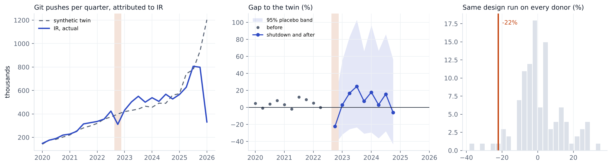

# Iran, 2022

Change in git pushes GitHub attributes to **IR** in 2022Q4, compared with a synthetic twin built from 106 economies. 10 quarters before the event are used to build the twin.

| Method | Change vs twin | 95% interval | p (normal) | p (permutation) |
|---|---|---|---|---|
| Synthetic DiD | -22.0% | -43% to +7% | 0.122 | 0.075 |
| Synthetic control | -23.8% | -47% to +10% | 0.144 | 0.112 |
| Augmented synthetic control | -23.0% | -43% to +5% | 0.097 | 0.103 |

**Checks**

* Conformal test. p = 0.091. With 11 quarters the smallest possible p is 0.091, so this test can't give an interval here.
* Backdating. Fitting without 2022Q1 and 2022Q2, the twin misses those quarters by -18%, -29%. Outside the placebo band, so the pre trend is shaky.
* Breakdown. The interval already includes zero, so there is nothing to break.
* Leave one donor out. Dropping each of the 28 donors with weight over 1% keeps the estimate between -22.9% and -20.5%.
* Holm adjusted p across the nine registry events is 0.664. Does not pass every check in the analysis plan, so I don't call it a clear drop.
* What happened. Mobile networks cut 4pm to midnight from 21 Sep to 3 Oct 2022 and again on 8, 12 and 15 Oct, regional outages, app stores and messaging apps blocked. Fixed line mostly stayed up. Source https://ooni.org/post/2022-iran-technical-multistakeholder-report/

Biggest donor weights: SA 0.09, UZ 0.09, LK 0.06, ID 0.06, JM 0.05, SG 0.05.

This is GitHub activity placed in the country by IP address, not national output. People on a VPN get placed wherever the VPN exits, and shutdowns usually come with other trouble (protests, conflict), so the gap is the change in attributed activity during everything that happened that quarter.
