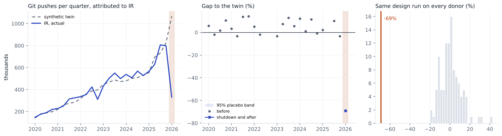

# Iran, 2026

Change in git pushes GitHub attributes to **IR** in 2026Q1, compared with a synthetic twin built from 106 economies. 21 quarters before the event are used to build the twin.

| Method | Change vs twin | 95% interval | p (normal) | p (permutation) |
|---|---|---|---|---|
| Synthetic DiD | -69.0% | -76% to -61% | <0.001 | 0.009 |
| Synthetic control | -70.4% | -77% to -62% | <0.001 | 0.009 |
| Augmented synthetic control | -70.4% | -77% to -62% | <0.001 | 0.009 |

**Checks**

* Conformal test. p = 0.045 (smallest possible 0.045), interval -79% to -65%.
* Backdating. Fitting without 2025Q3 and 2025Q4, the twin misses those quarters by +2%, -15%. Inside the placebo band.
* Breakdown. The twin's path would have to be off by 3.4 times the worst miss in the country's own past (fake events in earlier quarters) before the result goes away.
* Leave one donor out. Dropping each of the 31 donors with weight over 1% keeps the estimate between -69.2% and -68.7%.
* Holm adjusted p across the nine registry events is <0.001. Passes every check in the analysis plan.
* The twin rises with the jump of about 30% most economies had this quarter. Of four economies under broad sanctions, Russia, Belarus and Cuba mostly didn't get it and Venezuela did (+48%). If Iran had grown like the four on average, or stayed flat, the drop is 59% (flat) to 64% (growing like those economies) instead of 69%.
* What happened. Blackout from 8 Jan 2026 with partial return in late January, then a cut of more than 99 percent from 28 Feb 2026 that lasted past the end of the quarter. Source https://www.thenationalnews.com/future/technology/2026/05/07/iran-internet-blackout/

Biggest donor weights: UZ 0.09, KR 0.08, LK 0.05, SA 0.05, UA 0.05, AZ 0.05.

This is GitHub activity placed in the country by IP address, not national output. People on a VPN get placed wherever the VPN exits, and shutdowns usually come with other trouble (protests, conflict), so the gap is the change in attributed activity during everything that happened that quarter.
