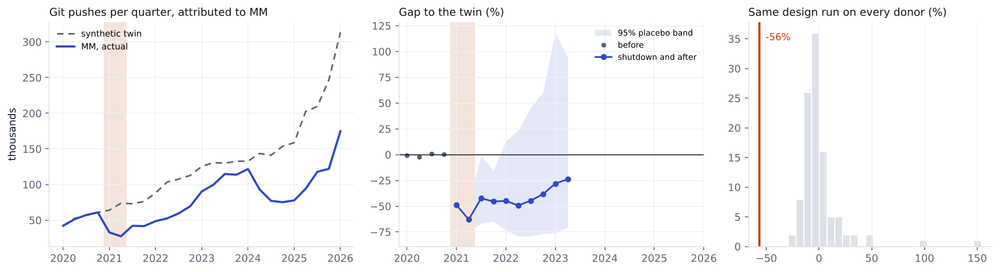

# Myanmar, 2021

Change in git pushes GitHub attributes to **MM** in 2021Q1, 2021Q2, compared with a synthetic twin built from 106 economies. 4 quarters before the event are used to build the twin.

| Method | Change vs twin | 95% interval | p (normal) | p (permutation) |
|---|---|---|---|---|
| Synthetic DiD | -56.4% | -69% to -39% | <0.001 | 0.019 |
| Synthetic control | -56.8% | -70% to -38% | <0.001 | 0.019 |
| Augmented synthetic control | -56.8% | -70% to -37% | <0.001 | 0.019 |

**Checks**

* Conformal test. p = 0.167. With 6 quarters the smallest possible p is 0.167, so this test can't give an interval here.
* Backdating. Too few pre quarters to hold any out.
* Breakdown. The twin's path would have to be off by 22.7 times the worst miss in the pre period fit (a weaker benchmark, there is too little history for fake events) before the result goes away.
* Leave one donor out. Dropping each of the 42 donors with weight over 1% keeps the estimate between -56.9% and -55.8%.
* Holm adjusted p across the nine registry events is <0.001. Passes every check in the analysis plan that can be run on it. Backdating can't, there are too few quarters before the event.
* What happened. Coup on 1 Feb 2021, 30 hour nationwide cut on 6 to 7 Feb, nightly cuts from 15 Feb to 28 Apr, all mobile data off from 15 Mar, then whitelisting. Source https://www.article19.org/resources/myanmar-must-immediately-reinstate-internet-access/

Biggest donor weights: MG 0.05, LB 0.04, RW 0.04, JM 0.03, UZ 0.03, PS 0.03.

This is GitHub activity placed in the country by IP address, not national output. People on a VPN get placed wherever the VPN exits, and shutdowns usually come with other trouble (protests, conflict), so the gap is the change in attributed activity during everything that happened that quarter.
