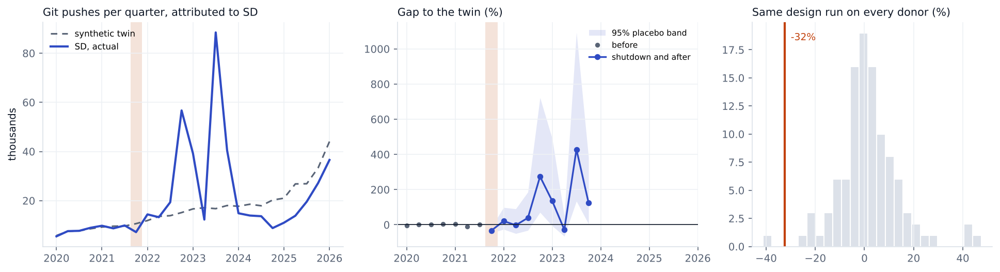

# Sudan, 2021

Change in git pushes GitHub attributes to **SD** in 2021Q4, compared with a synthetic twin built from 106 economies. 7 quarters before the event are used to build the twin.

| Method | Change vs twin | 95% interval | p (normal) | p (permutation) |
|---|---|---|---|---|
| Synthetic DiD | -32.5% | -47% to -13% | 0.002 | 0.019 |
| Synthetic control | -38.4% | -53% to -19% | <0.001 | 0.019 |
| Augmented synthetic control | -41.9% | -54% to -26% | <0.001 | 0.009 |

**Checks**

* Conformal test. p = 0.125. With 8 quarters the smallest possible p is 0.125, so this test can't give an interval here.
* Backdating. Fitting without 2021Q2 and 2021Q3, the twin misses those quarters by -25%, -11%. Outside the placebo band, so the pre trend is shaky.
* Breakdown. The twin's path would have to be off by 1.5 times the worst miss in the pre period fit (a weaker benchmark, there is too little history for fake events) before the result goes away.
* Leave one donor out. Dropping each of the 30 donors with weight over 1% keeps the estimate between -33.6% and -31.0%.
* Holm adjusted p across the nine registry events is 0.015. Does not pass every check in the analysis plan, so I don't call it a clear drop.
* What happened. Fixed and mobile internet cut on 25 Oct 2021 after the coup, services began returning 18 Nov 2021. Source https://pulse.internetsociety.org/en/shutdowns/internet-disruption-in-sudan/

Biggest donor weights: CY 0.06, PR 0.06, LV 0.05, PS 0.05, MD 0.05, SA 0.04.

This is GitHub activity placed in the country by IP address, not national output. People on a VPN get placed wherever the VPN exits, and shutdowns usually come with other trouble (protests, conflict), so the gap is the change in attributed activity during everything that happened that quarter.
